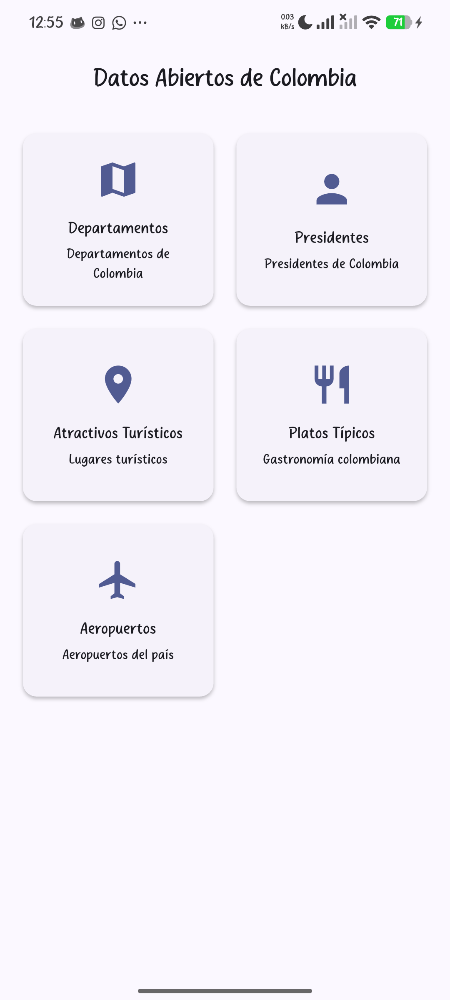
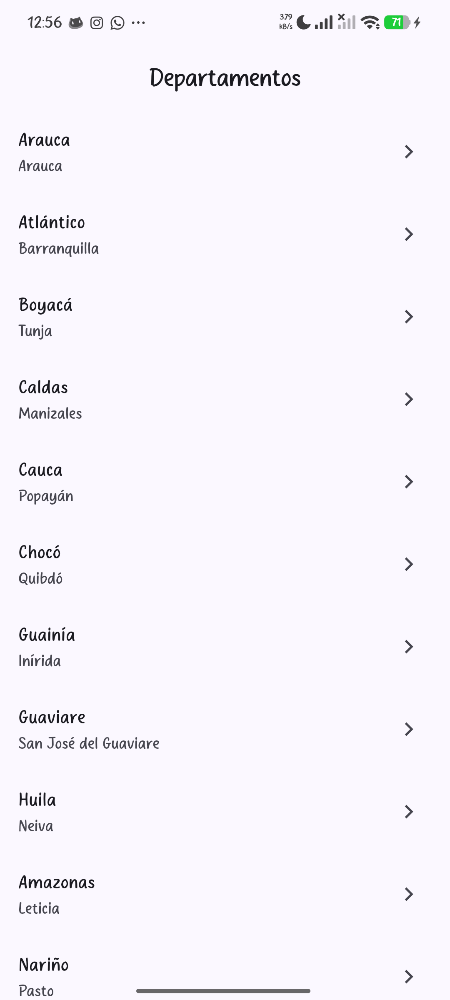
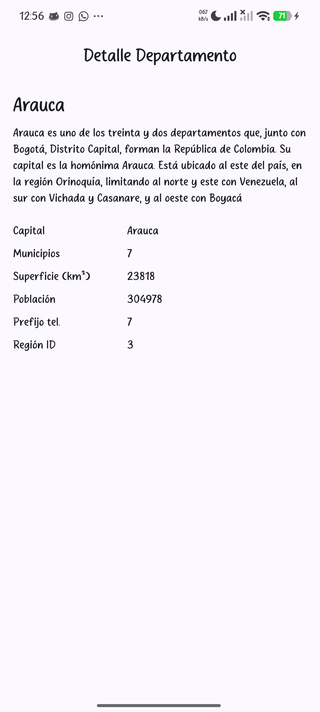

# Datos Abiertos de Colombia (Flutter)

Aplicación Flutter que consume la API pública [API Colombia](https://api-colombia.com/) para mostrar información de Colombia.

## Endpoints seleccionados

- `Department` (Departamentos)
- `President` (Presidentes)
- `TouristicAttraction` (Atractivos turísticos)
- `TypicalDish` (Platos típicos)
- `Airport` (Aeropuertos)

Base URL: `https://api-colombia.com/api/v1` (configurada en `.env`).

## Arquitectura

```
lib/
  config/      // configuración general (.env)
  models/      // modelos con fromJson y toJson
  routes/      // configuración de go_router
  services/    // llamadas HTTP (http)
  themes/      // estilos o temas globales
  views/       // pantallas principales (Dashboard, Listado, Detalle)
  widgets/     // componentes reutilizables
  main.dart
```

## Paquetes utilizados

- `http` — consumo de API.
- `go_router` — navegación entre pantallas.
- `flutter_dotenv` — manejo de variables de entorno.

## Rutas (go_router)

- `/` — Dashboard
- `/departments` — Listado de departamentos
- `/departments/:id` — Detalle de departamento
- `/presidents` — Listado de presidentes
- `/presidents/:id` — Detalle de presidente
- `/touristic-attractions` — Listado de atractivos turísticos
- `/touristic-attractions/:id` — Detalle de atractivo turístico
- `/typical-dishes` — Listado de platos típicos
- `/typical-dishes/:id` — Detalle de plato típico
- `/airports` — Listado de aeropuertos
- `/airports/:id` — Detalle de aeropuerto

## Ejemplo de respuesta JSON (Department)

```json
{
  "id": 1,
  "name": "Amazonas",
  "description": "Amazonas es uno de los treinta y dos departamentos...",
  "cityCapitalId": 1,
  "municipalities": 2,
  "surface": 109665,
  "population": 82068,
  "phonePrefix": "8",
  "regionId": 4
}
```

## Manejo de estados

Cada pantalla de listado y detalle maneja tres estados:
- Cargando (`CircularProgressIndicator`)
- Éxito (render de datos con `ListView.builder`)
- Error (mensaje + botón de reintento cuando aplica)

## Capturas de la aplicación

### Dashboard (Home)

Pantalla principal con cards para cada endpoint. Al tocar una card se navega al listado correspondiente.

### Listado (Departamentos)

Petición GET a la API, render con ListView.builder. Estados de carga, éxito y error (mensaje + reintentar).

### Detalle (Departamento)

Pantalla de detalle con información completa del registro seleccionado, navegación con go_router y paso de parámetros (id).

## Ejecución

```bash
flutter pub get
flutter run
```

Configurar `.env` con:

```
API_BASE_URL=https://api-colombia.com/api/v1
```
